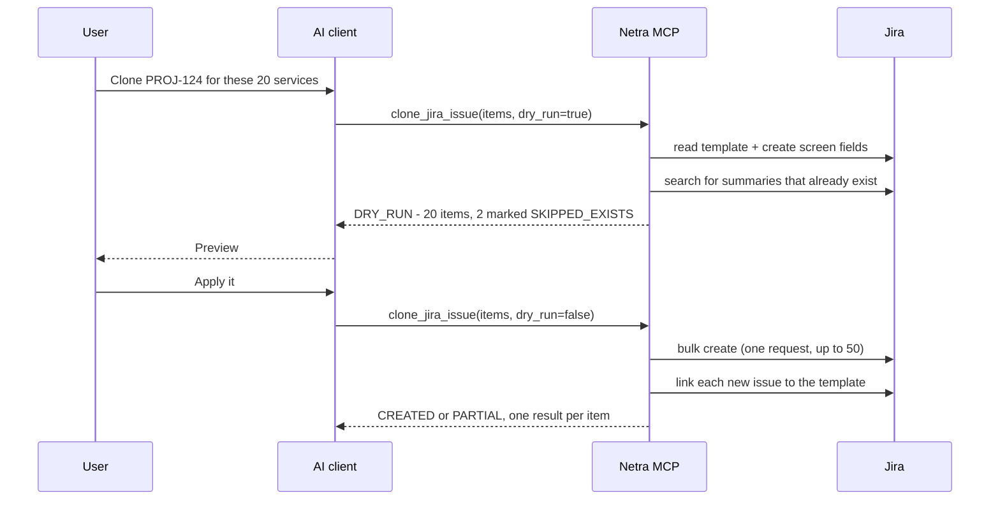

# Giving an AI Assistant Safe Write Access to Jira

Netra MCP started as a Confluence tool. Release reports in Confluence hold dozens of Jira macros, each with a JQL query pinned to a version string, and moving to the next release meant hand-editing every one of them. The server fixed that: an AI assistant inspects the page, previews every change, and writes the new version in one shot.

The next request was obvious. The same release work has a Jira side: one ticket per service or variant, cloned from a template and renamed by hand. Twenty services means twenty clones and twenty retyped summaries. So the requirement became a single sentence an engineer could say to Claude or Copilot:

> "Clone template ticket PROJ-124 and set the summary to `<project><variant><service name>`" - for one ticket, or for a whole list.

Reading Jira is easy. Letting an AI *write* to a shared backlog in bulk is where the design work is. This post is about that part.

<!-- more -->

**Links:**

- Source code: [github.com/sunishbharat/netra-confluence-mcp](https://github.com/sunishbharat/netra-confluence-mcp){ target="_blank" }
- Project page: [Netra MCP: Confluence and Jira Read/Write Server](../../portfolio/projects/netra-confluence-mcp.md)

## Bulk writes amplify every mistake

A single wrong edit is an annoyance. Fifty wrong tickets in a team's backlog are a cleanup job and a loss of trust in the tool. I wrote the Jira design around three rules that follow from that:

1. **Show every item before writing anything.** The dry run lists each issue that would be created, with its final summary and fields.
2. **A re-run after a partial failure must never create duplicates.** Jira's bulk endpoint is not transactional. Some items succeed, some fail, and the user will fix the input and run it again.
3. **The response must say exactly which items succeeded.** A bulk call that half-worked cannot hide behind a single `CREATED` status.

Everything else in the extension is in service of those three rules.

## Five tools, two releases

The work shipped in two steps in October 2026.

| Tool | What it does | Writes? |
|---|---|---|
| `clone_jira_issue` | Clones a template into 1-50 new issues | Yes, after dry run |
| `create_jira_issue` | Creates 1-50 issues without a template | Yes, after dry run |
| `edit_jira_issue` | Changes fields on one issue, with a before/after diff | Yes, after dry run |
| `get_jira_issue` | Reads one issue in plain language, optionally with comments | Never |
| `search_jira_issues` | Runs a JQL search, up to 100 results | Never |

Together with the five Confluence tools, the server now exposes ten.

The read tools came second, and they turned out to close the loop on the write tools. The assistant can read the template before cloning it, search for the clones afterwards to confirm they exist, and review a ticket on request: "is the description clear, are the acceptance criteria testable, what is missing before a developer can start?"

## How a bulk clone works

A few decisions in that flow are worth explaining.

**The client expands the summary pattern, not the server.** The server never interprets a template string like `<project><variant><service name>`. The AI client turns the user's list into concrete summaries and sends those. That way the dry run shows the exact text that will land in Jira, and the human approves real summaries rather than a pattern.

**Clones copy what the create screen accepts.** A template is valuable because of its custom fields, components, labels, and fix versions, not its summary. The clone copies every field the target project's create screen accepts, minus an exclude list, rather than a fixed short list that would silently drop the fields that matter.

**Overrides accept display names.** Users say "Service Name", not `customfield_10421`. Override keys resolve against a field ID or an exact display name, and an unknown key returns `VALIDATION_FAILED` before any write - as does a missing required field.

**Duplicates are skipped, not created.** Before writing, the server searches the target project for summaries that already exist and marks those items `SKIPPED_EXISTS`. If item 14 of 20 fails because of a bad field value, the user fixes the input and runs all 20 again. Only item 14 is created.

**Partial failure is a first-class status.** When some items succeed and some fail, the response is `PARTIAL`, with one entry per item. A clone that was created but whose link back to the template failed stays `CREATED` and carries a `link_error`, because the ticket exists and pretending otherwise would be worse.

## One shared server, every user as themselves

The server runs on Cloud Foundry as a shared team service, used from VS Code Copilot in Agent mode. That raises a question a local tool never has to answer: whose identity does a write use?

Not a service account. On HTTP transport the server holds no Atlassian identity at all. Each request carries the caller's email and API token as headers, and the server builds a fresh client per call. Jira's history shows the real person, and each user is bound by their own Jira permissions.

The Jira tools use `X-Jira-*` headers when present and fall back to the caller's `X-Confluence-*` pair. The two pairs are never mixed, and server environment credentials are never read on HTTP. A request without credentials gets an error, not a quiet fallback to some shared identity.

The client side of this is the part people will actually see: a VS Code `mcp.json` pointing at the route's `/mcp` endpoint, with the user's own credentials as headers.

## The client reads files; the server never does

One recipe that turned out useful is creating tickets from a file in the user's workspace - a Markdown file with one section per ticket, attached in Copilot with `#file:`. The tempting design is a tool that takes a file path. I deliberately did not build one.

On a shared HTTP deployment the server has no access to the user's machine, so a file-path tool would only work locally and fail confusingly in the deployment that matters. Instead the AI client reads the file and passes its contents to `create_jira_issue`. The server stays a pure Jira tool, and the same recipe works in both modes.

## What I learned

**Idempotency is the feature users never ask for and always need.** The requirement said "clone in bulk", not "safe re-runs". But a bulk write against a non-transactional API will partially fail sooner or later - one wrongly shaped field value is enough - and without duplicate detection the only recovery is manual cleanup. Designing for the re-run from the start is far cheaper than retrofitting it.

**A dry run that shows everything is worth more than a clever undo.** Jira has no transaction to roll back. The cheapest safety mechanism is making the preview complete enough that a human can catch the mistake before it happens - every item, every final summary.

**Tests do not cover packaging.** The Jira commit passed 234 tests, and the next Docker image would still have crashed on startup: the Dockerfile copied only the original packages, not the new `netra_jira/` one. Unit tests import from the source tree, so they could never see it. The fix was one line. The lesson is that a passing test suite says nothing about the image, and any new top-level package needs its own `COPY` line.

**Credentials fail differently in production.** The header fallback from Jira to Confluence credentials is tested and works in code. In real use on Cloud Foundry, Jira calls only worked once the Jira headers were set explicitly. My leading hypothesis is Atlassian's scoped API tokens, which are valid only for the products chosen when the token is created - a Confluence-scoped token fails on Jira. The known-good configuration sends both pairs, and the fallback stays documented with that caveat until the root cause is confirmed.

## What's next

The open items are a live sandbox check of a few Jira response shapes the code currently accepts in more than one form, confirming the token-scope hypothesis, and preserving @mentions and links when the read tools convert descriptions to plain text. Beyond that, OAuth 2.0 would replace per-user API tokens entirely.

---

- Source code: [github.com/sunishbharat/netra-confluence-mcp](https://github.com/sunishbharat/netra-confluence-mcp){ target="_blank" }
- Project page: [Netra MCP: Confluence and Jira Read/Write Server](../../portfolio/projects/netra-confluence-mcp.md)
