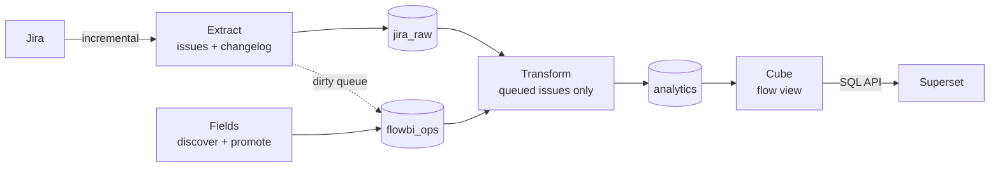

# OpenFlowBI: Jira Flow Metrics From the Changelog Up

As a program manager, the questions I care about most are not in Jira's current fields. How long does work actually sit in review? Where does it wait? Is throughput improving, or did we just close a lot of small tickets this sprint? The answers live in the changelog - every status transition every issue ever made.

The tool I use to get at them is eazyBI. It imports Jira's change history and turns it into measures like *days in transition status*, and it does that well. It is also a paid app whose licence, on Jira Cloud, follows the user count of the entire Jira site - so a large organisation pays for thousands of seats even when only a few people read the dashboards.

That raised a question I could not let go of: could the flow-metrics core of eazyBI be built entirely from free, open-source parts? So I built [OpenFlowBI](https://github.com/sunishbharat/open-flow-bi), a self-hosted pipeline for cycle time, time in status, and throughput. It works with Jira Cloud and Jira Server / Data Center, syncs incrementally, and installs with one script.

This post covers the shape of the pipeline, the parts that are harder than they look, and the bugs that would have quietly produced wrong numbers.

<!-- more -->

**Links:**

- Source code: [github.com/sunishbharat/open-flow-bi](https://github.com/sunishbharat/open-flow-bi){ target="_blank" }
- Project page: [OpenFlowBI: Open-Source Jira Flow Metrics](../../portfolio/projects/open-flow-bi.md)

## Borrowing eazyBI's model

eazyBI's design is proven, so I kept its shape and swapped every part for an open-source one:

| eazyBI | OpenFlowBI |
|---|---|
| Jira import with change history | `flowbi extract`, built on dlt, into Postgres |
| Choosing custom fields in the import options | `flowbi fields discover` and `promote`, guided by fill rates |
| Transition Status dimension, days in transition status | One row per status period per issue |
| Cube of dimensions and measures | A Cube semantic model with one `flow` view |
| Reports and dashboards | Apache Superset |

It is not a feature-for-feature replacement - eazyBI's calculated measures, multi-field history, and maturity go well beyond this. But for the flow questions above, the open-source stack is enough.

## Build nothing that already exists

Before writing code I wrote a library decision register: for every capability the pipeline needs, a decision to use a library, adapt one, or write it. The headline was that most of a "Jira extractor" is not Jira-specific at all. Pagination, incremental state, schema evolution, and loading into Postgres or Parquet are exactly what [dlt](https://dlthub.com) does. Data-quality contracts are pandera. The CLI is typer, logging is structlog, timezones are pendulum.

What is left is the irreducible, Jira-specific part - a few hundred lines by the register's estimate:

- detecting Cloud versus Server/DC and choosing the auth strategy
- a three-tier strategy for fetching complete changelogs
- mapping fields by name and type, since field IDs differ per instance
- the rules for when a changelog counts as complete, and where an issue's history starts

That rule kept the project small enough to finish, and it focused the testing effort on the code that could actually be wrong in a way nobody else had already solved.

## The pipeline

Four commands and two services:

1. **Extract** pulls new and changed issues and their full status history into a raw schema, and queues the changed issues.
2. **Fields** measures how often each field is actually filled in and records which ones to promote to real columns.
3. **Transform** rebuilds only the queued issues into an analytics schema: one row per issue, and one row per status period.
4. **Cube** turns those tables into named dimensions and measures, exposed as a single `flow` view. **Superset** connects to Cube's SQL API as if it were Postgres, so charts need no SQL.

## The changelog is harder than it looks

**It records transitions, not state.** An issue created straight into "To Do" has no transition into "To Do". Compute time in status from transitions alone and every issue's first status period disappears. The transform starts each issue's history at its creation date, with the initial status inferred from the first transition's "from" value.

**It arrives in pages, through three APIs.** Jira can embed the changelog in a search response, but the embedded copy is itself paginated and truncated for busy issues. So the extractor uses three tiers: the embedded changelog when it is complete, the bulk changelog endpoint (up to 1,000 issues per request) when it is not, and per-issue paging as the last resort. Every issue carries a `changelog_complete` flag, so incomplete history is never silently treated as complete.

**Cloud search is eventually consistent.** An update can become searchable some time after it happened. If the incremental watermark has already moved past that update's timestamp, the issue is never fetched. The fix is an overlap window: each run re-reads the last hour and lets idempotent merges absorb the duplicates.

## Choosing fields without guessing

A real Jira instance can have 200+ fields, most of them empty for any given project. Promoting all of them makes the analytics table unusable. Picking them by hand is not repeatable and leaves no record of why a column exists.

`flowbi fields discover` samples up to 5,000 issues and computes a fill rate per field, treating Jira's empty arrays and empty strings as unfilled. `flowbi fields promote` records the decision in a versioned log and queues a rebuild. The transform then materializes the column from data already in Postgres, without calling Jira again. Every column in the analytics table can be traced back to a recorded decision.

## The bugs the tests could not see

After the pipeline worked end to end, I wrote an architecture review: every module checked against the design documents, looking specifically for ways the numbers could be wrong. It found 19 issues. Six were critical, meaning data silently lost or wrong. The uncomfortable part was the review's own conclusion: most of them were invisible to the test suite, because they only appear with real timezones, real concurrency, real data volume, or a real Cloud tenant.

The clearest example was the incremental cursor. It compared Jira's raw `updated` strings, and the comparison was lexical, not chronological. I confirmed it with a two-run probe:

1. Run 1 advanced the watermark to `2024-10-27T02:30:00.000+0200` - 00:30 UTC.
2. Run 2 saw an update at `2024-10-27T02:10:00.000+0100` - 01:10 UTC, forty minutes *later* in real time.
3. The update was dropped, because as a string it sorts lower.

Any Jira not running on UTC would lose updates in the daylight-saving fall-back hour every year, with no error anywhere. The fix was a timezone-aware datetime cursor, which also unlocked the overlap window above. Other critical findings included offset paging on Data Center that could skip issues while the result set shifted, and a bulk changelog fetch that was marked complete without being paginated.

All six critical findings are fixed, each with a regression test. Four design-level findings remain open and are scoped separately.

## Making it installable by non-developers

A flow-metrics tool is only useful if the people who want the metrics can run it. The quickstart script asks a few questions in a single menu, installs the Docker stack, loads 50 issues, and finishes with the dashboard URL and login. With the defaults it uses Apache's public Jira, so anyone can see it working before connecting their own instance. If it is interrupted, running it again picks up where it left off, and later runs only fetch what changed.

Just as much care went into the failure paths: Docker not running, a corporate proxy breaking TLS, a wrong Jira token, Superset pointed at `localhost` instead of the Cube container. Each stops with a message that says what to do next, and the full output is saved to a log file for anyone asking for help.

## What I learned

**A string that looks like a timestamp is not a timestamp.** Lexical comparison of ISO-8601 strings works right up until two values carry different UTC offsets. Treat time as typed data at the boundary, and test across a DST transition on purpose.

**Read what your libraries actually do, not what you assumed.** The decision register originally assumed dlt used httpx, and two httpx-only libraries - a response cache and a request mocker - sat in the project unused. Reconciling the register against the installed code showed dlt's REST client is built on requests, so neither could ever have worked. Both were removed. A decision register is only as good as its last check against reality.

**Green tests are not evidence the numbers are right.** Unit tests with recorded fixtures prove the code does what I intended. They cannot prove I intended the right thing for timezones, eventual consistency, or concurrent runs. A deliberate review against the design, looking only for silent data loss, found what hundreds of passing tests did not.

**Semantic layers earn their place early.** Putting Cube between Postgres and Superset felt like extra infrastructure for a small project. In practice it means "cycle time" is defined once, in the model, rather than re-derived in every chart - and a CI smoke job can query the `flow` view end to end on every push.

## What's next

The roadmap is a browser screen for choosing which fields to promote, row-level security so each user sees only their own projects, prebuilt images on a public registry, and deployment beyond a single Docker Compose host. Wiring Jira Cloud's reported rate-limit budget into the extractor is also still open.

---

- Source code: [github.com/sunishbharat/open-flow-bi](https://github.com/sunishbharat/open-flow-bi){ target="_blank" }
- Project page: [OpenFlowBI: Open-Source Jira Flow Metrics](../../portfolio/projects/open-flow-bi.md)

<small>eazyBI is a trademark of its owner. OpenFlowBI is an independent open-source project and is not affiliated with or endorsed by eazyBI.</small>
