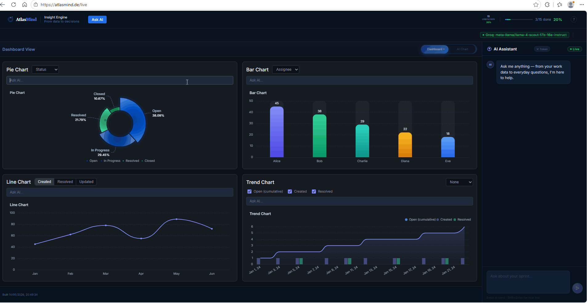

# Sunish Bharathan

### Leads programs. Writes code. Delivers AI.

I bridge engineering execution and business delivery, taking complex, multi-team software from regulated embedded systems all the way to production LLM deployments.

[View Projects :material-arrow-right:](portfolio/index.md){ .md-button .md-button--primary }
[Get in Touch](#contact){ .md-button }

<!-- Hero visual: live AtlasMind product demo. Swap to a headshot any time by changing the src below. -->

[atlasmind.de :material-arrow-top-right:](https://atlasmind.de){ .demo-caption target="_blank" rel="noopener" }

  

    20+ yrs  · multi-OEM
    Delivering complex, multi-team software programs
  

  

    Embedded · AI
    C/C++, FPGA, RTOS, ASIL-B → RAG, pgvector, LLMs in production
  

  

    AtlasMind &middot; Live on OCI
    Solo-deployed on Oracle Cloud · replaces 20+ hrs/week of Jira reporting
  

## About

I deliver complex, multi-team software programs in highly regulated environments (ASIL-B, ASPICE L2). With 20+ years of experience, I bridge the gap between engineering execution and business delivery.

I specialize in cross-team integration, task-level dependency tracking, and setting up Agile governance structures from scratch. I maintain a hands-on focus in embedded systems and modern generative AI architectures.

## Skills

A rare combination: **safety-critical program delivery** and hands-on **production GenAI**.

-   **Delivery & Management**

    ---

    - SAFe (Certified Agilist)
    - Scrum / Kanban / PI Planning
    - ASPICE L1/L2 & ASIL-B
    - Audit Artifact Automation
    - PMO Scaling & Governance

-   **AI & Software Systems**

    ---

    - RAG & pgvector (embeddings)
    - LLM Routing (Ollama, vLLM)
    - Python (FastAPI, PyTorch)
    - C / C++ (Embedded & RTOS)
    - Docker / Linux / DevOps

-   **Tools & Platforms**

    ---

    - Jira & EazyBi Dashboards
    - Agile Hive / Confluence
    - Jenkins CI/CD Pipelines
    - Oracle Cloud (OCI) & AWS
    - Git & Version Control

## Featured Projects

-   **AtlasMind: Production AI Assistant**

    ---

    A live natural language to JQL dashboard and query tool using RAG and pgvector. Features runtime LLM routing across 5 backends, self-healing query retries, and GPU inference. Deployed solo on Oracle Cloud A1.

    `Python` `FastAPI` `pgvector` `Ollama` `vLLM` `Oracle Cloud`

    [Read more :material-arrow-right:](portfolio/projects/atlasmind.md)

-   **Netra MCP: Confluence and Jira Read/Write Server**

    ---

    MCP server that lets Claude or GitHub Copilot edit Confluence pages and read, search, clone, bulk-create, and edit Jira issues. Dry-run by default, per-user credentials, deployed as a shared team server on Cloud Foundry.

    `Python` `FastMCP` `MCP` `Jira` `Confluence`

    [Read more :material-arrow-right:](portfolio/projects/netra-confluence-mcp.md)

-   **OpenFlowBI: Open-Source Jira Flow Metrics**

    ---

    Inspired by eazyBI, built to be a free alternative. See how long tickets spend in each status, where work waits, and how much gets finished - rebuilt from Jira's full history, in dashboards you host yourself.

    `Python` `dlt` `PostgreSQL` `Cube` `Superset`

    [Read more :material-arrow-right:](portfolio/projects/open-flow-bi.md)

[View all projects :material-arrow-right:](portfolio/index.md)

## Featured Articles

-   **Building AtlasMind-Netra: An AI Agent and MCP Server for Jira**

    ---

    *June 28, 2026 - 8 min read*

    How I built the AI agent and MCP server layer of AtlasMind - clarifying ambiguous Jira queries through conversation before dispatching to the JQL pipeline.

    [Read article :material-arrow-right:](blog/posts/atlasmind-netra-mcp-server.md)

-   **Processing Large Documents on Free-Tier LLMs Without Hitting Rate Limits**

    ---

    *June 29, 2026 - 10 min read*

    How I built limitless-llm - an open-source Python tool for reliable large document processing on free-tier LLMs, with a rolling TPM rate limiter and bidirectional context continuity.

    [Read article :material-arrow-right:](blog/posts/limitless-llm.md)

[View all articles :material-arrow-right:](blog/index.md)

## Contact { #contact }

I am open to discussing technical program management, engineering leadership, or AI delivery roles across Europe.

[sunishb@gmail.com](mailto:sunishb@gmail.com){ .md-button .md-button--primary }
[LinkedIn :fontawesome-brands-linkedin:](https://linkedin.com/in/sunishbharathan){ .md-button target="_blank" }
[GitHub :fontawesome-brands-github:](https://github.com/sunishbharat){ .md-button target="_blank" }
[atlasmind.de :material-arrow-top-right:](https://atlasmind.de){ .md-button target="_blank" }
