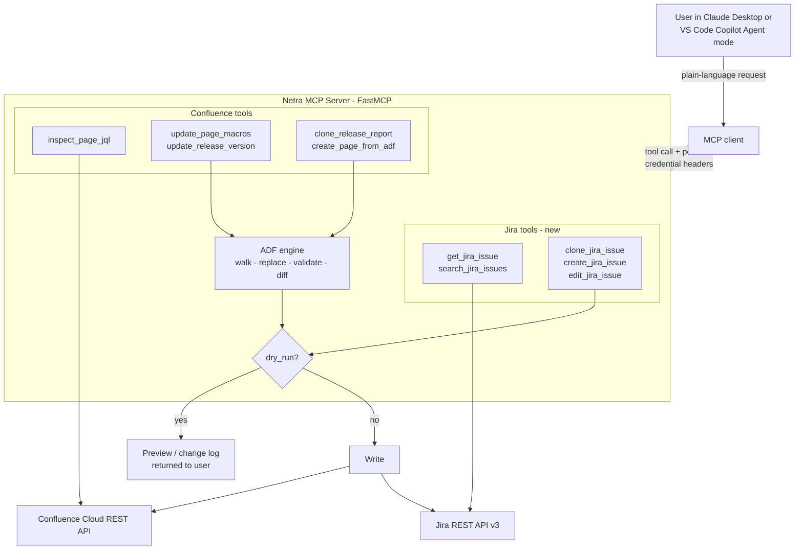

# Netra MCP: Confluence and Jira Read/Write Server

!!! abstract "Summary"
    **Type**: Open-source tool - Atlassian automation for AI assistants
    **Stack**: Python, FastMCP 2.0, httpx (async), Pydantic, Docker, Cloud Foundry

    **Key outcomes:**

    - 10 MCP tools across Confluence and Jira, usable from Claude Desktop, VS Code Copilot Agent mode, and any MCP-compatible client
    - **New (Oct 2026): Jira read and write** - read and search issues, clone a template ticket into up to 50 issues, bulk-create, and edit fields
    - Every write tool defaults to `dry_run=True`: nothing changes until the user says "apply it"
    - Confluence pages edited in their native ADF JSON at exact paths - no regex anywhere
    - Deployed on Cloud Foundry as a shared server; each user's own Atlassian token travels per request, so page history and Jira audit logs show the real person
    - 268 tests, 95% coverage on the Jira package, `ruff` and `mypy --strict` clean

!!! tip "What's new: Jira read/write support"
    The server started as a Confluence page editor. Two releases in October 2026 extended it to Jira:

    - **Write** (`clone_jira_issue`, `create_jira_issue`, `edit_jira_issue`): clone a template ticket and set each summary from a pattern, create tickets in bulk from a file in your workspace, or change fields on one issue. All three preview every item before writing.
    - **Read** (`get_jira_issue`, `search_jira_issues`): read a ticket in plain language - description as text, custom fields by display name, links, sub-tasks, recent comments - or run a JQL search with extra columns. Lets the AI check a template before cloning, verify the clones afterwards, and review a ticket's readiness.

## Challenge

Release work on Atlassian tools is full of repetitive, error-prone edits. A release report in Confluence can hold dozens of Jira macros, each with a JQL query pinned to a version string. Moving to the next release means hand-editing every macro, every date, and every version token, then hoping none were missed. On the Jira side, each rollout means creating the same ticket again and again - one per service or variant - by cloning a template and retyping the summary.

AI assistants can describe these changes easily but had no safe way to make them. A tool that writes to shared team pages and project backlogs has to be predictable: show exactly what will change, never touch the wrong node, survive a teammate editing the same page, and act as the real user rather than a shared service account.

## Approach

**Confluence: structure-aware edits, not text substitution**

The server reads pages as ADF (Atlassian Document Format), the JSON tree Confluence stores internally. A walker tracks the exact path to every node; an inspector extracts every JQL query with its location; a replacer applies longest-match-first rules scoped to the right macro parameters, protects @mentions, and regenerates macro IDs on clones. A validator checks the structure before any write, and a differ produces a grouped change log for the dry-run preview. Version conflicts (someone else saved the page) are retried with exponential backoff.

**Jira: bulk operations that are safe to re-run**

The Jira extension adds an async `JiraClient` that mirrors the Confluence client - typed errors per status code, HTTP 429 retries honouring `Retry-After`, and network retries only on idempotent calls, never on a POST whose response was lost.

- **Clone and create** handle 1-50 issues per call. Fields are copied from the template's create screen with an exclude list, override keys accept a field ID or its display name ("Service Name"), and missing required fields return `VALIDATION_FAILED` before any write.
- **Idempotent re-runs**: summaries that already exist in the project are marked `SKIPPED_EXISTS`, so after fixing one failed item the whole batch can be run again and only the missing issues are created. Partial failures return a `PARTIAL` status with one result per item.
- **Clones link back** to their template with an "is cloned by" link.
- **Read tools** render issues for an AI to reason about: ADF converted to plain text, users by display name, custom fields resolved via `expand=names`, and the 20 most recent comments.

**Multi-user by design**

On a shared HTTP deployment the server holds no Atlassian identity of its own. Each tool call carries the caller's email and API token as request headers, and the server builds a fresh client per call. Jira tools use `X-Jira-*` headers when present and fall back to the caller's `X-Confluence-*` pair - never mixing pairs, and never reading server environment credentials on HTTP. A structlog processor redacts any credential-shaped log field as a backstop.

## Architecture

## Example requests

> "Show me every JQL query on page 123456."

> "Change V10.0 to V20.0 across the release report. Show me the dry run first."

> "Clone PROJ-124 for each service in #file:services.md and set the summary to `[Hadoop][vari-12] <service> ingestion retries`."

> "Read PROJ-1285 including comments: are the acceptance criteria testable, and what is missing before a developer can start?"

## Tech Stack

| Layer | Technology |
|---|---|
| MCP server | FastMCP 2.0 (stdio locally, stateless streamable HTTP when shared) |
| HTTP clients | httpx (async), tenacity retries |
| Data models | Pydantic, pydantic-settings |
| Confluence | REST API, ADF walker / replacer / validator / differ |
| Jira | REST API v3 - createmeta, bulk create, issue links, JQL search |
| Deployment | Docker (multi-arch amd64 + arm64), Cloud Foundry |
| Quality | pytest (268 tests), ruff, mypy --strict |

## Links

[View Code (GitHub) :fontawesome-brands-github:](https://github.com/sunishbharat/netra-confluence-mcp){ .md-button .md-button--primary target="_blank" }
[Related: AtlasMind-Netra :material-arrow-right:](atlasmind-netra.md){ .md-button }
[Read the blog post :material-arrow-right:](../../blog/posts/netra-jira-read-write.md){ .md-button }
