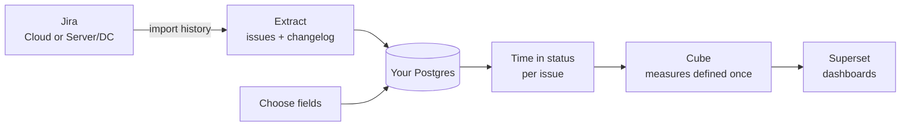

# OpenFlowBI: Open-Source Jira Flow Metrics

**See how work really flows through your Jira projects** - how long tickets spend in each status, where they wait, and how many get finished each week - in dashboards you host yourself, for free.

OpenFlowBI started with one question: *can the flow metrics teams buy eazyBI for be built entirely from free, open-source parts?* This project is the answer.

-   :material-help-circle-outline:{ .lg .middle } **The questions**

    ---

    How long does work sit in review? Where does it wait? Is the team finishing more, or just closing smaller tickets? The answers live in Jira's change history.

-   :material-currency-usd-off:{ .lg .middle } **The cost**

    ---

    eazyBI answers these questions well. It is also a paid app, licensed by the number of users on the whole Jira site - not by how many people read the dashboards.

-   :material-source-branch:{ .lg .middle } **The alternative**

    ---

    OpenFlowBI rebuilds the same core metrics from Jira's history using only open-source tools, on your own machine. Free, MIT-licensed, and yours to change.

!!! abstract "Summary"
    **Type**: Open-source tool - free alternative for Jira flow metrics (September - October 2026) 
    **Stack**: Python, dlt, PostgreSQL, Cube, Apache Superset, Docker

    **What you get:**

    - Cycle time, time in status, and throughput, rebuilt from every issue's complete change history
    - No licence and no per-user cost - MIT-licensed open source
    - Your Jira data stays in your own Postgres database
    - Works with Jira Cloud and Jira Server / Data Center
    - Incremental sync: after the first load, each run fetches only what changed
    - One-script install, with a ready-made demo on Apache's public Jira - no account needed to try it

## Why eazyBI was the reference

I build delivery dashboards in eazyBI, and for Jira flow reporting it sets the standard. Its key move is importing each issue's change history and turning it into measures such as *days in transition status*. That is exactly what flow metrics need: not where a ticket is now, but how long it spent everywhere along the way.

The catch is the licence. On Jira Cloud, eazyBI's price tier follows the user count of the whole Jira site. A site with 2,000 users pays at the 2,000-user tier, even if only a handful of delivery leads open the dashboards. There is a 30-day trial but no permanent free tier.

So the direction for OpenFlowBI was clear: **keep eazyBI's proven model** - import the history, choose the fields, define the measures once, explore in dashboards - and **rebuild it with open-source building blocks.**

## eazyBI concepts, open-source building blocks

If you know eazyBI, you already know how OpenFlowBI works. Each familiar step has an open-source counterpart:

| In eazyBI you... | In OpenFlowBI | Built with |
|---|---|---|
| Import Jira issues with change history | `flowbi extract` pulls issues and their full changelog, incrementally | dlt, PostgreSQL |
| Choose which custom fields to import | `flowbi fields` shows how often each field is actually filled in, then you promote the ones you want | Versioned decision log in Postgres |
| Analyse the *Transition Status* dimension and *days in transition status* | One row per status period for every issue, starting at its creation | SQL transform |
| Work with a cube of dimensions and measures | A semantic model that defines each measure once, exposed as a single `flow` view | Cube |
| Build reports and dashboards | Point-and-click charts and dashboards in the browser, no SQL needed | Apache Superset |
| Pay a licence per Jira user | Free | MIT licence |

## An honest comparison

OpenFlowBI is not a feature-for-feature replacement for eazyBI. It covers the flow-metrics core - and is open about where the mature product still leads.

-   :material-check-circle-outline:{ .lg .middle } **Where OpenFlowBI shines**

    ---

    - No licence cost, whatever the size of your Jira site
    - Your data never leaves your server
    - Open code you can read, audit, and extend
    - Plain SQL access to the same data, for any other tool
    - Built on widely used open-source components

-   :material-timer-sand:{ .lg .middle } **Where eazyBI still leads**

    ---

    - Years of maturity and vendor support
    - Rich calculated measures (MDX) and time intelligence
    - Change history for many fields - OpenFlowBI models status history today
    - Many data sources beyond Jira
    - Ready-made report templates and gadgets inside Jira
    - Per-user access control (on the OpenFlowBI roadmap)

## Under the hood

Turning Jira's history into trustworthy numbers is harder than it looks. Four problems shaped the design:

- **History records transitions, not state.** An issue's first status never appears as a transition, so each issue's timeline is anchored at its creation date. Without this, every first status period would silently disappear.
- **Changelogs come back in pages, through three different APIs.** The extractor uses the embedded changelog when it is complete, falls back to the bulk endpoint (up to 1,000 issues per request), then to per-issue paging - and flags any issue whose history is incomplete.
- **Jira Cloud search lags behind recent changes.** Each sync re-reads a one-hour overlap window, so late-indexed updates are never missed, and duplicates merge away.
- **Real instances have 200+ fields, most of them empty.** Field discovery samples up to 5,000 issues and measures fill rates, so the choice of columns is based on data and recorded in a versioned log.

The project follows a "build nothing that already exists" rule: dlt handles pagination and loading, Cube the semantic layer, Superset the dashboards. Hand-written code is limited to what is specific to Jira.

## Quality

- 185 tests, with recorded responses from both Jira Cloud and Data Center
- Postgres integration tests against a real database in CI
- An end-to-end CI check that migrates a fresh database, starts Cube, and queries the `flow` view
- A written architecture review hunting specifically for silent wrong numbers: all six critical findings fixed, each with a regression test

## Roadmap

- A browser screen for choosing which Jira fields to promote
- Row-level security, so each user sees only their own projects
- Prebuilt images on a public registry
- Deployment beyond a single Docker Compose host

## Tech Stack

| Layer | Technology |
|---|---|
| Extraction | dlt, pyrate-limiter |
| Storage | PostgreSQL, Alembic; optional Parquet output |
| Data quality | pandera, SQL checks |
| Semantic layer | Cube |
| Dashboards | Apache Superset |
| CLI | typer, rich, structlog |
| Testing | pytest, vcrpy, testcontainers |
| Packaging | Docker Compose, uv |

## Links

[View Code (GitHub) :fontawesome-brands-github:](https://github.com/sunishbharat/open-flow-bi){ .md-button .md-button--primary target="_blank" }
[Read the blog post :material-arrow-right:](../../blog/posts/open-flow-bi.md){ .md-button }

<small>eazyBI is a trademark of its owner. OpenFlowBI is an independent open-source project and is not affiliated with or endorsed by eazyBI.</small>
